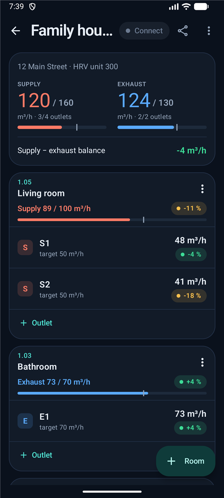
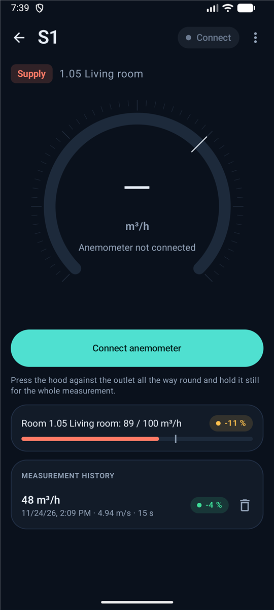
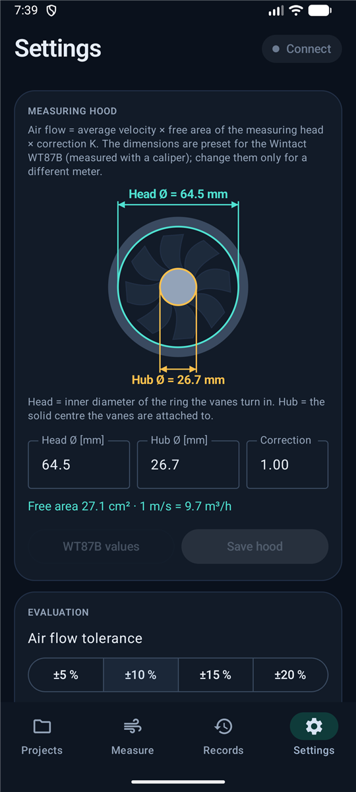

# Anemometr

Android app for the **Wintact WT87B** Bluetooth anemometer, built for balancing residential ventilation (supply and exhaust air flows room by room).

Aplikace pro Android k Bluetooth anemometru **Wintact WT87B**, určená k zaregulování větrání v rodinných domech a bytech (přívod a odvod vzduchu po místnostech).

**[⬇ Stáhnout / Download APK](../../releases/latest)**

<p>
  
  
  
</p>

[Čeština](#čeština) · [English](#english)

---

## Čeština

### Co aplikace umí
- **Projekty → místnosti → vyústky.** U místnosti zadáte projektovaný průtok přívodu/odvodu a počet vyústek. Každá vyústka dostane stejný podíl jako cíl a součet naměřených vyústek se porovná s průtokem místnosti.
- **Měření s měřicím trychtýřem.** Průtok = průměrná rychlost × volná plocha hlavy anemometru × korekce K. Rozměry hlavy WT87B (Ø 64,5 mm, náboj Ø 26,7 mm) jsou přednastavené.
- **Vyhodnocení podle tolerance** (±5 až ±20 %), bilance přívod − odvod a protokol do CSV pro Excel.
- **Živé měření** rychlosti (m/s, km/h, kn, mph, ft/min) nebo průtoku (m³/h) s grafem, teplotou a vlhkostí. Jednotku přepnete ťuknutím na hodnotu.
- **Záznamy** průběhu rychlosti s grafem, který si můžete prohlížet prstem.
- Čeština, angličtina, polština a němčina.

### Instalace (krok za krokem)
Aplikace není v Google Play, instaluje se ze souboru APK.

1. V telefonu otevřete stránku **[Releases](../../releases/latest)** a klepněte na soubor `Anemometr-…apk`.
2. Prohlížeč se může zeptat, jestli soubor opravdu stáhnout. Potvrďte **Stáhnout**.
3. Po stažení klepněte na **Otevřít**. Telefon napoprvé zobrazí, že instalace z tohoto zdroje není povolená. Klepněte na **Nastavení** a zapněte **Povolit z tohoto zdroje**, pak se vraťte zpět.
4. Klepněte na **Instalovat**. Pokud se objeví varování Google Play Protect („neznámý vývojář“), zvolte **Další podrobnosti → Přesto nainstalovat**.
5. Při prvním spuštění povolte přístup k **zařízením v okolí** (Bluetooth), jinak se aplikace k anemometru nepřipojí.

**Požadavky:** Android 8.0 nebo novější s Bluetooth LE. Anemometr Wintact WT87B (v seznamu zařízení se hlásí jako „Anemometer“).

**Aktualizace:** stáhněte novější APK ze stejné stránky a nainstalujte ho přes stávající aplikaci, data zůstanou zachovaná.

### Upozornění
- Aplikace není nijak spojená s výrobcem Wintact. Název WT87B slouží jen k označení podporovaného přístroje.
- Komunikační protokol přístroje byl zjištěn pouze kvůli kompatibilitě. Aplikace neobsahuje kód ani grafiku výrobce.
- Výsledky závisí na těsnosti trychtýře a korekci K. Pro závazná měření použijte kalibrovaný přístroj.

---

## English

### Features
- **Projects → rooms → outlets.** Enter the design supply/exhaust air flow and the number of outlets for each room. Each outlet gets an equal share as its target, and the sum of the measured outlets is compared with the room flow.
- **Measuring with a hood.** Air flow = average velocity × free area of the anemometer head × correction K. The WT87B head dimensions (Ø 64.5 mm, hub Ø 26.7 mm) are preset.
- **Evaluation against a tolerance** (±5 to ±20 %), supply − exhaust balance and a CSV report for Excel.
- **Live view** of velocity (m/s, km/h, kn, mph, ft/min) or air flow (m³/h) with a chart, temperature and humidity. Tap the value to switch units.
- **Recordings** of velocity over time with a chart you can scrub through.
- English, Czech, Polish and German.

### Installation (step by step)
The app is not on Google Play; you install it from an APK file.

1. On your phone, open the **[Releases](../../releases/latest)** page and tap the `Anemometr-…apk` file.
2. Your browser may ask whether to keep the file. Tap **Download**.
3. When it has downloaded, tap **Open**. The first time, Android says installing from this source is not allowed. Tap **Settings**, turn on **Allow from this source**, then go back.
4. Tap **Install**. If Google Play Protect warns about an unknown developer, choose **More details → Install anyway**.
5. On first start, allow access to **Nearby devices** (Bluetooth); otherwise the app cannot connect to the anemometer.

**Requirements:** Android 8.0 or newer with Bluetooth LE. A Wintact WT87B anemometer (it appears as "Anemometer" in the device list).

**Updating:** download the newer APK from the same page and install it over the existing app; your data is kept.

### Disclaimer
- This app is not affiliated with Wintact. The name WT87B is used only to identify the supported meter.
- The meter's communication protocol was studied only for interoperability. The app contains no code or graphics from the manufacturer.
- Results depend on how well the hood seals and on the correction factor K. Use a calibrated instrument for binding measurements.

---

## Building from source

Requirements: Android Studio (it bundles the JDK) and the Android SDK.

```powershell
.\gradlew assembleRelease
```

The APK is written to `app/build/outputs/apk/release/`. Without the maintainer's signing key (configured in a git-ignored `.env`), the release build is signed with your local debug key, which is fine for installing on your own phone.

Tech: Kotlin, Jetpack Compose, Material 3, Bluetooth LE (Android 12+ permissions).

## License

[MIT](LICENSE)
